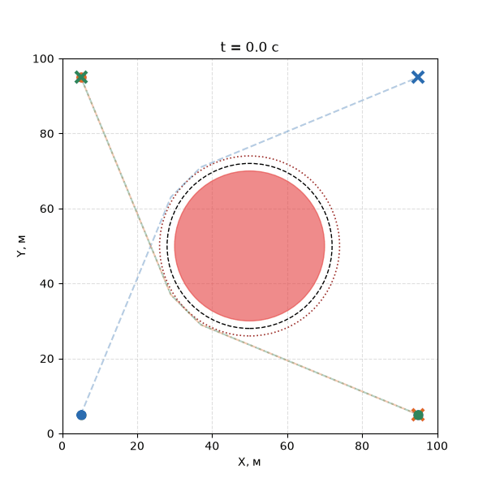
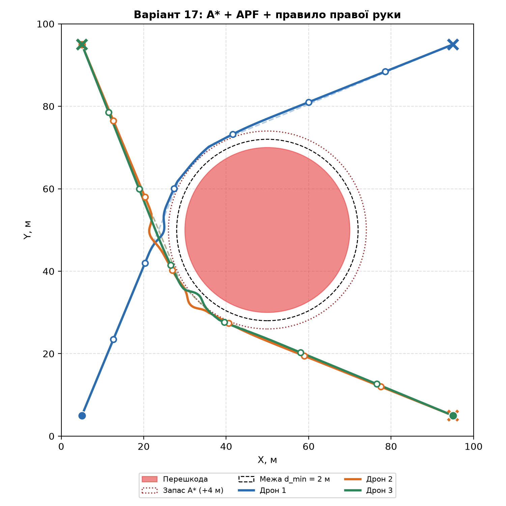

# Практичне заняття 1 (індивідуальне завдання №1), варіант 17

> **Примітка.** Це раніше зроблене розширене рішення з власною реалізацією (`swarm.py`) і правилом «правої руки»
> для тих самих даних варіанта 17. Основне рішення, що спирається на прототип викладача, лежить на рівень вище
> ([README](../README.md)). Залежності: `pip install -r ../requirements.txt`; запуск з цього каталогу.

**Система управління рухом дронів до своїх цілей за наявності перешкод із механізмом A\* оптимізації маршрутів.**
Дисципліна «Математичне моделювання та обчислювальні методи», ЗУНУ.

**Автор:** Осадчук Сергій, аспірант 1 року навчання, Західноукраїнський національний університет.

Децентралізоване керування групою з трьох дронів: **глобальний маршрут A\*** на сітці
та **локальне уникнення зіткнень** методом штучних потенційних полів (APF)
з правилом «правої руки».



## Умова (варіант 17, «Обхід по великому радіусу»)

| Дрон | Старт → ціль |
|---|---|
| 1 | (5, 5) → (95, 95) |
| 2 | (5, 95) → (95, 5) |
| 3 | (95, 5) → (5, 95) |

Перешкода: центр (50, 50), R = 20. Поле 100 × 100 м.
Критерій успіху: досягти цілей за мінімальний час, не наближаючись один до одного
або до перешкоди ближче ніж `d_min = 2.0`.

## Результат

| Конфігурація | Час, с | Мін. між дронами, м | Мін. до перешкоди, м |
|---|---|---|---|
| A\* + відштовхування (як у прикладі) | 89.8 | 2.47 | 2.48 |
| **A\* + відштовхування + права рука** | **69.3** | **3.04** | **2.94** |
| A\* + відштовхування + зупинки | 79.0 | 2.25 | 2.26 |
| A\* + права рука + зупинки | 71.4 | 3.15 | 3.25 |

Нижня межа часу для довжини маршруту A\* (136.9 м) при `v_max = 2 м/с` — 68.5 с.
Основна конфігурація відстає від неї лише на ≈ 1 %.



## Як запустити

```bash
python3 -m venv .venv && source .venv/bin/activate
pip install -r requirements.txt

python run_variant17.py --gif     # розрахунок, графіки, таблиця, анімація -> results/
python sensitivity.py             # перевірка стійкості до параметрів
python -m unittest -v             # автотест критерію d_min
```

## Структура

| Файл | Призначення |
|---|---|
| `swarm.py` | `AStarPlanner`, `Drone`, `Simulation`, метрики |
| `run_variant17.py` | дані варіанта 17, графіки, порівняння конфігурацій |
| `sensitivity.py` | розгортка параметрів (23 запуски) |
| `test_variant17.py` | автотест |
| `results/` | графіки, GIF, `metrics.json`, `sensitivity.json` |

## Припущення

- Дрон — точка; `d_min` застосовується до відстані між центрами дронів
  і до щілини між центром дрона та краєм перешкоди.
- `v_max = 2.0 м/с` (в умові не задано); час масштабується обернено до `v_max`.
- Двофазне синхронне оновлення: спочатку всі швидкості, потім усі позиції.
- Дрон, що досяг цілі, лишається на місці як нерухомий об'єкт.
