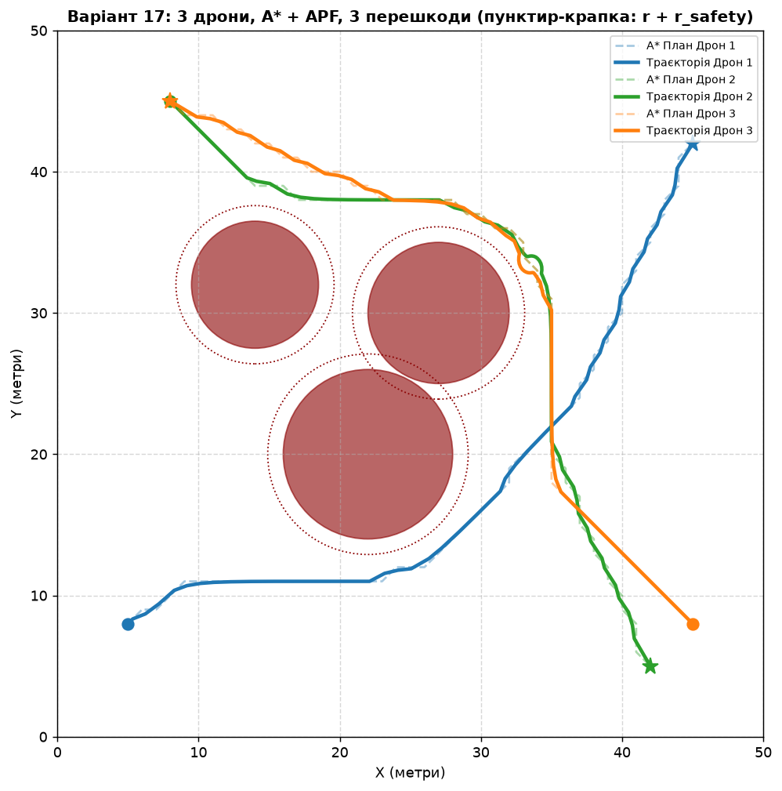

# Практичне заняття 4, варіант 17

**Система управління рухом дронів до своїх цілей за наявності перешкод із механізмом A\* оптимізації маршрутів.**
Дисципліна «Математичне моделювання та обчислювальні методи», ЗУНУ.
**Автор:** Осадчук Сергій, аспірант 1 року навчання.

Три дрони: глобальний маршрут A\* на сітці + локальне відштовхування між дронами (прототип викладача
`Prakt_4_1General+++.pdf`), дані варіанта 17 з `Prakt_4_2_var21+++.pdf`.

| Дрон | Старт → ціль |
|---|---|
| 1 | (5, 8) → (45, 42) |
| 2 | (8, 45) → (42, 5) |
| 3 | (45, 8) → (8, 45) |

Перешкоди `(x, y, R)`: (22, 20, 6), (27, 30, 5), (14, 32, 4.5). Запас безпеки `r_safety = 1.1 м`. Поле 50 × 50 м.



Усі три дрони досягли цілей за 51.4 с, мінімальний просвіт до перешкод 1.66 м (≥ 1.1 м), мінімальна відстань
між дронами 1.18 м. Що саме змінено у прототипі і чому — у [CHANGES.md](CHANGES.md).

## Як запустити

```bash
python3 -m venv .venv && source .venv/bin/activate
pip install -r requirements.txt

python run_original_headless.py   # 1) оригінал прототипу без змін -> results/original_final_frame.png
python run_params_only.py         # 2) оригінал + лише числа варіанта -> results/params_only.png
python run_variant17.py           # 3) адаптований код -> results/variant17_final.png, metrics.json
python sensitivity.py             # розгортка margin і параметрів відштовхування
python -m unittest -v             # автотест
```

## Структура

| Файл | Призначення |
|---|---|
| `original/astar_apf_original.py` | прототип з PDF (відновлені відступи, скорочені коментарі) |
| `astar_apf_variant17.py` | адаптований код: дані варіанта 17, правки C1–C6 |
| `run_original_headless.py`, `run_params_only.py`, `run_variant17.py` | три запуски: оригінал, лише підстановка, остаточний |
| `sensitivity.py`, `test_variant17.py` | розгортка параметрів, автотест |
| `CHANGES.md`, `results/changes.diff` | що змінено: артефакти PDF, обмеження прототипу, зміни для варіанта |
| `extended_100x100/` | раніше зроблене розширене рішення за таблицею `Prakt_4_2_var21.pdf` (поле 100 × 100) |

## На заліку з іншим варіантом

У `astar_apf_variant17.py` змінюється лише секція «0. ДАНІ ВАРІАНТА»: `OBSTACLES`, `STARTS`, `GOALS`, `R_SAFETY`.
Решту (правки C2–C5) можна лишити: вони не залежать від варіанта. Порядок дій: [WORKFLOW.md](../WORKFLOW.md).
